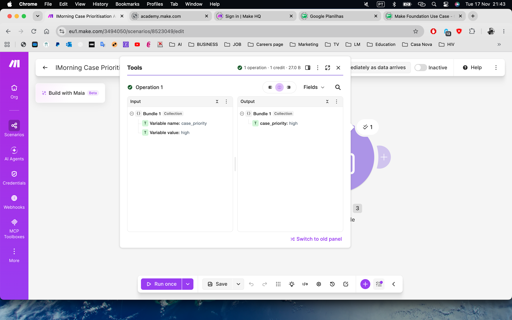
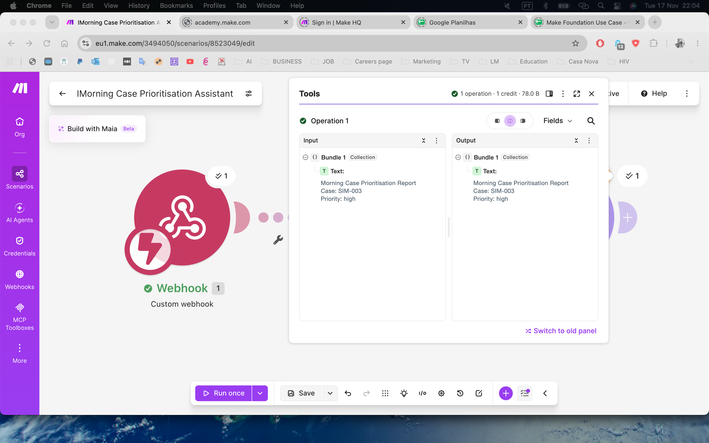
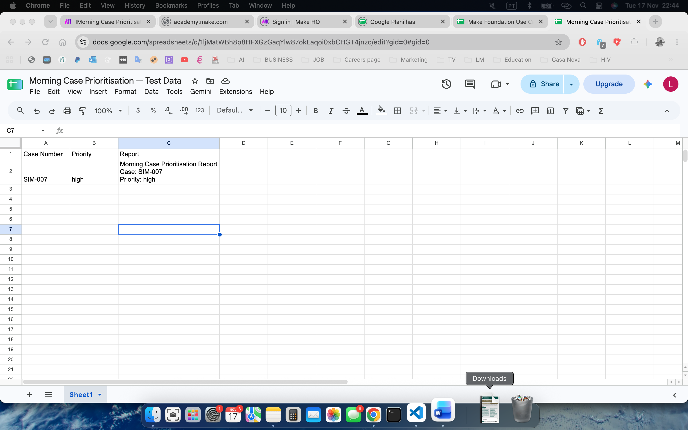

# Automation 1 — Morning Case Prioritisation Assistant

## Business Problem

In Sales Operations, reviewing pending support cases is a regular manual task. At the beginning of the working day, case information, new replies and manager priority requests must be checked across different systems.

Cases need to be prioritised based on factors such as manager requests, opportunity close dates, business urgency and case age. Comparing this information manually can take approximately 5–15 minutes. The wider morning review, including replies and follow-ups, can take around 30 minutes.

The proposed automation will organise fictional case records into a prioritised list, helping the user identify which cases require attention first.

This is an academic simulation using fictional data only. It will not connect to corporate Salesforce, Slack or email accounts.

## Trigger

The automation will start when a custom webhook receives fictional case data.

Make.com will use an event-based webhook trigger to start the workflow. The data will include case identifiers, creation dates, reply status and business priority information.

For the first version, the webhook will be triggered manually using test data. A scheduled morning report may be added later.

## Steps

1. A custom webhook in Make.com receives fictional case data in JSON format.
2. The Tools — Set variable module evaluates manager_priority and new_reply to classify each case as high, medium or low.
3. The Tools — Compose a string module generates a report containing the case number and calculated priority.
4. The Google Sheets — Add a Row module records the case number, priority and report in a personal test spreadsheet.
5. The workflow was tested with fictional cases SIM-003, SIM-004 and SIM-005 to verify high, medium and low priorities.
6. A complete workflow test using SIM-007 successfully added a new row to Google Sheets.

The Flask endpoint /hooks/prioritise was developed and tested separately. It returned HTTP 200 for valid JSON and HTTP 400 for incomplete data. Flask is not directly connected to the Make.com scenario.

The current Make.com workflow processes one fictional case per webhook request. It does not yet implement case-age ordering, duplicate detection or scheduled execution. Gmail delivery was attempted but was not completed because the connection lacked the required permissions. Google Sheets was used instead.

All case information will be fictional. No corporate accounts or systems will be connected.

## Failure Questions

### What if the automation fires twice?

The same case could appear twice in the report, causing confusion. Each case will have a unique identifier. Duplicate case entries should be detected during processing so that the final report does not repeat them.

### What if a step fails halfway through?

If a step fails, the automation should report the error rather than present incomplete results as successful. Invalid input should be rejected by the Flask handler with an appropriate HTTP status code. Other failures will need to be tested and documented.

### What data crosses a third party, and is any of it personal?

Fictional case information will pass through Make.com and the connected test services. The simulation will use invented case numbers, dates and business information, without real customer or employee data. No corporate Salesforce, Slack or email accounts will be connected.

## Test Evidence

The automation was tested using fictional case data.

| Test | Expected Result | Actual Result | Status |
|---|---|---|---|
| Manager priority (SIM-003) | high | high | Passed |
| New reply (SIM-004) | medium | medium | Passed |
| No urgent flags (SIM-005) | low | low | Passed |
| Report generation (SIM-003) | Case number and priority | Report generated correctly | Passed |
| Google Sheets integration (SIM-007) | New row added | Row added with case number, priority and report | Passed |
| Flask valid JSON (SIM-001) | HTTP 200 | HTTP 200 | Passed |
| Flask incomplete JSON (SIM-002) | HTTP 400 | HTTP 400 | Passed |
| Gmail delivery (SIM-006) | Email sent | HTTP 403 — insufficient OAuth permissions | Failed |

### Screenshots

